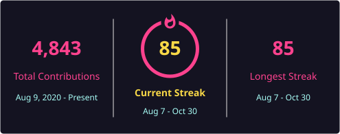

<p align="center">
  <a href="https://readme-typing-svg.demolab.com/demo/">
    
  </a>
</p>

<p align="center">
  <a href="https://github.com/kory-kaai/cn-lint"><strong>cn-lint</strong></a> ·
  <a href="https://github.com/kory-kaai/monetready"><strong>Monetready</strong></a> ·
  <a href="https://github.com/kory-kaai/collab-kit"><strong>collab-kit</strong></a> ·
  <a href="https://github.com/topdaily-dev/repomark"><strong>repomark</strong></a> ·
  <a href="https://github.com/topdaily-dev/badgekit"><strong>badgekit</strong></a> ·
  <a href="https://github.com/topdaily-dev/shipkit"><strong>shipkit</strong></a> ·
  <a href="https://monetready.com">monetready.com</a> ·
  <a href="https://korykaai.com">Portfolio</a> ·
  <a href="https://linkedin.com/in/korykaai">LinkedIn</a> ·
  <a href="https://x.com/korykaai">X</a>
</p>

<p align="center">
  <a href="https://github.com/kory-kaai?tab=followers"></a>
  <a href="https://github.com/kory-kaai/cn-lint/stargazers"></a>
  <a href="https://github.com/kory-kaai/monetready/stargazers"></a>
  <a href="https://github.com/kory-kaai/collab-kit/stargazers"></a>
  <a href="https://github.com/kory-kaai/shipkit/stargazers"></a>
</p>

---

### Building now

**[cn-lint](https://github.com/kory-kaai/cn-lint)** — reports the Tailwind class that `cn()` deletes, and the class that won.

```bash
npm install -D github:kory-kaai/cn-lint
npx cn-lint src
```

**[Monetready](https://github.com/kory-kaai/monetready)** — the open-source product forge. Score SaaS revenue readiness, run lifecycle playbooks, and launch from one spec.

```bash
npx create-monetready my-saas
npx monetready-cli score
```

**[collab-kit](https://github.com/kory-kaai/collab-kit)** — PR templates, CI, git hooks, and team docs in one command.

```bash
npx @korykaai/collab-kit init . --oss-toolchain
collab-kit enable-hooks .
```

**OSS toolchain** ([@topdaily-dev](https://github.com/topdaily-dev)) — badges, repo health, and releases:

```bash
npx @topdaily-dev/repomark check .
npx @topdaily-dev/badgekit row ci npm license --owner YOU --repo YOUR_REPO --npm @scope/pkg
npx @topdaily-dev/shipkit ship --patch --yes
```

See [examples/oss-toolchain.md](https://github.com/kory-kaai/collab-kit/blob/main/examples/oss-toolchain.md).

---

<h2 align="center">Merged upstream</h2>

<p align="center">
  Three pull requests, merged by the people who maintain the projects.
</p>

<table>
<tr>
<td align="center" valign="top" width="33%">
<a href="https://github.com/motdotla/dotenv/pull/1075"></a>
<br /><br />
<em>nice contribution! thank you</em>
<br /><br />
<a href="https://github.com/motdotla/dotenv/pull/1075#issuecomment-6224592992"><strong>Scott Motte</strong></a>
<br />
<sub>fast parser tests</sub>
</td>
<td align="center" valign="top" width="33%">
<a href="https://github.com/expressjs/multer/pull/1454"></a>
<br /><br />
<em>This was fast @kory-kaai! Great work!</em>
<br /><br />
<a href="https://github.com/expressjs/multer/pull/1454#pullrequestreview-5010332788"><strong>Ulises Gascón</strong></a>
<br />
<sub>preservePath coverage</sub>
</td>
<td align="center" valign="top" width="33%">
<a href="https://github.com/react-hook-form/react-hook-form/pull/13821"></a>
<br /><br />
Approved and merged
<br /><br />
<a href="https://github.com/react-hook-form/react-hook-form/pull/13821#pullrequestreview-5396939478"><strong>Bill</strong></a>
<br />
<sub>safeJSON tests</sub>
</td>
</tr>
</table>

---

### Featured repos

<p align="center">
  <a href="https://github.com/kory-kaai/cn-lint">
    
  </a>
</p>

<p align="center">
  <a href="https://github.com/kory-kaai/collab-kit">
    
  </a>
  <a href="https://github.com/kory-kaai/repomark">
    
  </a>
</p>

<p align="center">
  <a href="https://github.com/kory-kaai/badgekit">
    
  </a>
  <a href="https://github.com/kory-kaai/shipkit">
    
  </a>
</p>

<p align="center">
  <a href="https://github.com/kory-kaai/repomark-action">
    
  </a>
  <a href="https://github.com/kory-kaai/monetready">
    
  </a>
</p>

---

### GitHub activity

<p align="center">
  
  
</p>

<p align="center">
  
</p>

---

### Projects

| | |
| :-- | :-- |
| [**cn-lint**](https://github.com/kory-kaai/cn-lint) | Reports Tailwind classes that `cn()` and `twMerge()` silently drop |
| [**Monetready**](https://github.com/kory-kaai/monetready) | Monetready Score · revenue playbooks · launch automation |
| [**collab-kit**](https://github.com/kory-kaai/collab-kit) | PR templates, CI, git hooks, and team docs in one command |
| [**repomark**](https://github.com/topdaily-dev/repomark) | OSS repo health score + safe scaffolding |
| [**badgekit**](https://github.com/topdaily-dev/badgekit) | shields.io README badge rows from the terminal |
| [**shipkit**](https://github.com/topdaily-dev/shipkit) | Safe OSS releases — changelog, tag, GitHub release, npm publish |
| [**Systems Implementation Playbook**](https://github.com/kory-kaai/Systems-Implementation-Playbook) | Delivery frameworks for implementation work |
| [**Portfolio**](https://github.com/kory-kaai/technical-project-manager-portfolio) | Selected technical project work |

### Toolkit

<p align="center">
  
</p>

`TypeScript` · `Node.js` · `React` · `Next.js` · `PostgreSQL` · `Docker` · `GitHub Actions` · `npm`

### About

Technical Project Manager — requirements, stakeholder coordination, implementation, and documentation across finance, federal, healthcare, and B2B.

U.S. Army veteran · BS Business Administration · Fluent in Italian

---

### Contribution graph

<picture>
  <source media="(prefers-color-scheme: dark)" srcset="https://raw.githubusercontent.com/kory-kaai/kory-kaai/main/output/snake-dark.svg" />
  <source media="(prefers-color-scheme: light)" srcset="https://raw.githubusercontent.com/kory-kaai/kory-kaai/main/output/snake.svg" />
  
</picture>

---

<p align="center">
  
</p>
